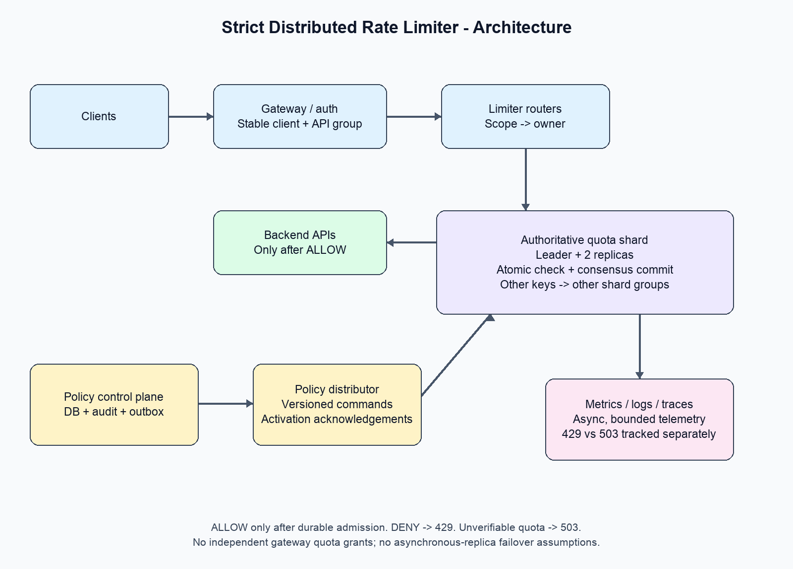
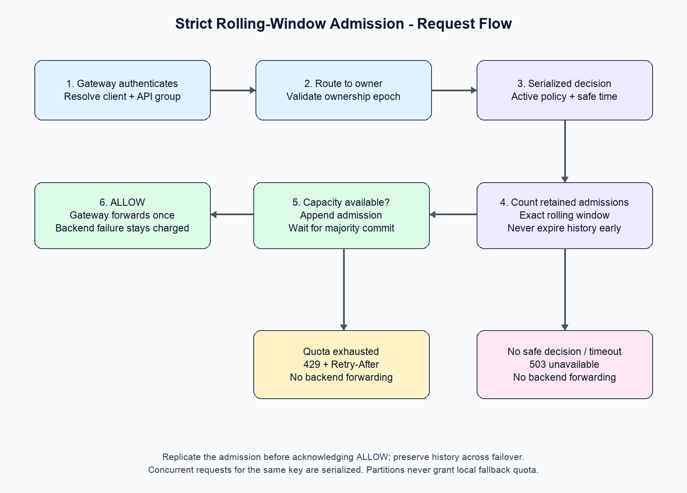

# Distributed API Rate Limiter - Strict Rolling-Window Design

## 1. Problem and Design Contract

Build a distributed limiter that protects multiple APIs from numerous clients, supports dynamic policies and priority tiers, and adds minimal request latency.

**Decisions confirmed for this design:**

- A policy such as 100 requests per 60 seconds means no more than 100 admissions in **any rolling 60-second interval**, not a calendar minute.
- Limits are shared across API servers; adding gateways must not multiply a client's quota.
- **Fail closed:** if authoritative quota cannot be verified, do not forward the request.
- Return **429** for a known exhausted quota and **503** for unavailable quota verification.

This design deliberately differs from `rate-limiter-hld-design.md`, which allows approximation and defaults to fail open.

### What exactly are we counting?

Count admission decisions, including admitted requests whose backend later fails. A rejected request does not consume quota for that policy.

The guarantee is about admission time, not backend completion time or concurrent requests. Delayed requests can still overlap at the backend; add a separate concurrency limiter when required.

For scope key `k`, limit `L`, window `W`, and authoritative time `t`:

```text
admit only if count(admissions for k in (t - W, t]) < L
```

Decisions must be serialized for a key. Client timestamps are never authoritative.

## 2. Scope and Assumptions

| Area | Assumption |
|---|---|
| Identity | Authenticated tenant/client ID; API key resolves to stable client ID |
| Anonymous callers | Separate IP-based policy using trusted proxy metadata |
| Scope | Client-wide, client + API group, optional API-wide capacity cap |
| Group definition | Stable route IDs, not arbitrary URL strings |
| Main operation | Admit immediately or reject; no request queue |
| Changes | Limits/tier assignments change without restarts |
| Deployment | Regional data plane; each scope has one authoritative owner group |
| Normal added latency | Target 5 ms p95, 10 ms p99 in-region; validate by benchmarking |
| Failure behavior | Safety over availability during partitions |

Requests are not automatically retried after uncertain admission. A timeout may already have consumed quota. Prefer conservative under-admission to accidentally granting a duplicate permit.

## 3. Capacity Estimation

Illustrative large-scale assumptions, not measured capacity:

| Metric | Estimate |
|---|---:|
| Average incoming traffic | 100,000 requests/s |
| Peak traffic | 500,000 requests/s |
| Active clients per minute | 1 million |
| Enforced scopes per request | 2 typical, 3 with aggregate cap |
| Decision operations at peak | 1-1.5 million/s |
| Typical rolling window | 60 seconds |
| Maximum supported history horizon | 1 hour, configurable with provisioning |

At 100,000 admitted requests/s and a 60-second window, roughly 6 million timestamps are retained **per enforced scope**. At a full hour, that becomes 360 million. Longer windows materially increase storage and compaction cost.

A compact 24-40 byte admission record is only a starting point: indexes, scope IDs, replication, log overhead, policy data, and deduplication increase memory/storage. With two scopes and three replicas, even the 60-second case has roughly 864 MB-1.44 GB of raw replicated records before those overheads.

Shard by scope key and benchmark sustained replicated writes, hot-key contention, expiration work, and recovery. Cluster-wide QPS does not imply a single scope can sustain that QPS.

## 4. Algorithm Choice

| Algorithm | Main advantage | Why not the default here? |
|---|---|---|
| Fixed-window counter | Constant space, simple | Boundary bursts can exceed a rolling-window limit |
| Sliding-window counter | Low memory | Approximation can over-admit |
| Token bucket | Supports average rate and bursts | Does not directly enforce an exact rolling-window quota |
| Leaky bucket / queue | Smooth output | Different semantics; may delay requests |
| Exact sliding-window log | Matches requirement | Timestamp storage and serialized writes cost more |

Choose an **exact sliding-window log** with conservative time handling. A short-window log alone is insufficient if administrators can immediately increase the configured window; retain history for the maximum supported horizon or delay activation.

## 5. High-Level Architecture



```text
Client -> Gateway/auth -> Limiter routers -> Authoritative quota shard
                   |                              |
                   |                       leader + 2 replicas
                   |                       consensus committed log
                   |
                   +-> ALLOW: backend API
                   +-> DENY: 429
                   +-> UNKNOWN/unavailable: 503

Admin -> Policy API -> Policy DB + outbox -> Policy distributor
                                             |
                                             v
                                    Quota shard policy commands

Gateways + quota shards -> metrics/logs/traces -> dashboards/alerts
```

### Components and reasons

| Component | Responsibility and justification |
|---|---|
| Gateway middleware | Authenticate, resolve client/API group, enforce decision before forwarding |
| Limiter router | Route a scope to its owner shard; stateless and horizontally scalable |
| Quota shard | Serialize policy/state changes and admission commands |
| Three-replica consensus group | Preserve committed admissions across one-node failure |
| Policy control plane | Validate, audit, version, distribute, and track activation of rules |
| Observability pipeline | Aggregate admission/failure/latency information asynchronously |

The limiter does not call the policy database, a message broker, or analytics synchronously for each request. Backend services must not be reachable through a path that bypasses enforcement.

### Why not simply Redis?

Redis sorted sets plus an atomic Lua script are a useful **single-primary** implementation of a sliding-window log. But atomicity on one primary is not the same as durable, linearizable failover:

- Asynchronous replication can lose acknowledged admissions when a replica is promoted.
- Losing admissions replenishes quota and can violate the strict guarantee.
- Replica reads can observe stale quota.
- Replication acknowledgements alone should not be described as a complete consensus/fencing guarantee.

For this requirement, use a quota service backed by a proven consensus implementation, with majority-committed writes and fenced ownership. Do not build a consensus protocol from scratch. A Redis-based alternative is acceptable only if its actual failure contract satisfies the same safety requirements, or if the product explicitly relaxes strictness.

## 6. API Design

### Public API response

Allowed requests proceed normally. Exhausted quota:

```http
HTTP/1.1 429 Too Many Requests
Retry-After: 12
Content-Type: application/json

{
  "code": "RATE_LIMIT_EXCEEDED",
  "policyId": "client-api-standard",
  "retryAfterSeconds": 12
}
```

`Retry-After` is rounded up to the earliest safe retry time for the violated policy. With several exhausted policies, use the largest applicable delay. It is advisory: another request may consume capacity first.

Unavailable enforcement:

```http
HTTP/1.1 503 Service Unavailable
Content-Type: application/json

{
  "code": "RATE_LIMITER_UNAVAILABLE",
  "message": "Quota could not be verified. Request was not forwarded."
}
```

### Internal admission API

```text
CheckAndConsume(
  authenticatedClientId,
  apiGroupId,
  gatewayAttemptId,
  cost = 1
) -> ALLOW | DENY | UNAVAILABLE
```

Gateway identity and attempt ID are trusted internal values, not caller-controlled headers. Each forwarded attempt needs its own quota admission. An API's business idempotency key is separate.

In the simplest safe version, do not replay a successful admission after an ambiguous timeout. Rechecking can charge twice but cannot over-admit. If retryable decision IDs are added, they require a bounded deduplication period, permit expiry, and enforcement that a recorded permit authorizes at most one forwarded attempt.

### Policy management

```http
PUT /v1/rate-limit-policies/{policyId}
If-Match: "version-16"
```

```json
{
  "scope": "CLIENT_API_GROUP",
  "clientId": "client_123",
  "apiGroupId": "search",
  "maxRequests": 100,
  "windowSeconds": 60,
  "priorityTier": "STANDARD"
}
```

Return the new version and `PENDING` activation status. A status API exposes acknowledged enforcement versions and activation failures. Updating durable configuration is not the same as activating it everywhere.

## 7. Data Model and Ownership

### Durable control-plane tables

```text
policies:
  policy_id, scope, selector, max_requests, window_seconds,
  priority_tier, version, desired_status, created_at, updated_at

policy_rollouts:
  policy_id, version, target_owner, applied_version, status, last_error

audit_log:
  change_id, actor_id, policy_id, before_value, after_value, changed_at

outbox:
  event_id, policy_id, version, payload, published_at
```

Validate positive limits/windows, allowed selectors, and maximum history horizon. Authenticate administrators and require tenant-scoped permissions.

### Quota state

```text
scope_key = tenantId/clientId/apiGroupId/policyId as applicable

quota_state:
  scope_key
  active_policy_version
  retained_admissions: ordered timestamps + request identifiers/cost
  ownership_epoch
```

Use unambiguous canonical encoding or length-prefixed components for keys. Policy limit changes do not create an empty quota key: preserve existing history.

Cold history can reside in an embedded ordered store with recent state cached in memory. Persist commands in the replicated log and periodically snapshot state to bound recovery time.

## 8. Complete Request Flow



1. **Authenticate:** the gateway resolves a stable client/tenant ID. IP limits are supplementary, not a substitute for client identity.
2. **Normalize route:** map `/orders/123` to a stable API group such as `orders.read`; otherwise callers can create unbounded keys.
3. **Route:** a limiter router finds the authoritative shard for the scope.
4. **Serialize:** the leader validates its ownership and processes the command using the active policy.
5. **Calculate occupancy:** count admissions still inside the rolling window.
6. **Decide:** if exhausted, return a denial and safe retry delay. Otherwise append the admission through consensus.
7. **Wait for commit:** only a majority-committed admission can produce `ALLOW`.
8. **Enforce:** gateway forwards once on `ALLOW`, returns 429 on `DENY`, and 503 on timeout or unavailable enforcement.
9. **Observe:** record outcome counters and sampled traces asynchronously.

### Atomic state-machine operation

```text
Within the ordered shard state machine:
  read active policy
  obtain validated authoritative time bounds
  select retained admissions not proven older than window
  if sum(costs) + request.cost > limit:
      DENY with conservative retry delay
  else:
      record admission
      return ALLOW only after consensus commit
```

This is not a read-then-write performed by gateway nodes. Concurrent requests for the same key are ordered at one owner.

### Example

Client A has 99 admissions in the last 60 seconds. Two gateways submit simultaneously. The owner orders the requests:

```text
Request 100: count=99 -> commit admission -> ALLOW
Request 101: count=100 -> DENY
```

No separate lock service is needed; the state machine supplies serialization.

## 9. Clock Correctness

Rolling windows depend on elapsed time. Consensus ordering alone does not stop a fast clock or a new leader's forward clock jump from expiring admissions too early.

Use a validated time source with explicit uncertainty bounds:

- At admission, record an upper bound on admission time.
- At evaluation, use a lower bound on current time.
- An admission can leave the window only when `currentLowerBound >= admissionUpperBound + window`.
- Uncertainty can reject requests longer than necessary, but must not release quota early.
- If time bounds become invalid or unbounded, fail closed; restore trusted time before resuming.

This is a required infrastructure dependency, not an assumed property of ordinary NTP. A deployment without trustworthy clock bounds must use a conservative recovery pause, with adequate clock-drift margins, before releasing uncertain history after failover. Do not clear state or trust a new leader's wall clock.

## 10. Several Policies per Request

A request may require all of:

```text
client-wide quota
client + API-group quota
API-wide safety cap
```

Co-locate client-wide and client/API-group keys by `hash(tenantId, clientId)` so they can be checked and charged atomically within one shard.

An API-wide cap typically has a different owner. Two choices:

| Approach | Benefit | Cost |
|---|---|---|
| Sequential conservative reservations | Simple; each cap remains safe | An earlier quota may be charged even if a later policy rejects |
| Cross-shard transaction | All-or-none charging | Extra coordination, latency, and failure complexity |

Use conservative reservations initially. **Do not refund on ambiguous failures:** a refund racing with forwarding can permit overshoot. Denote these as quota reservations/attempts in billing and metrics, not completed backend requests.

If accurate all-or-none accounting is a contractual requirement, introduce a real distributed transaction or redesign ownership. Do not claim that independent shard checks are atomic.

## 11. Dynamic Policy Updates

Control-plane flow:

```text
Admin -> validate + audit + commit policy/outbox
     -> distribute versioned command
     -> owner commits policy change in its ordered log
     -> acknowledge applied version
     -> rollout becomes ACTIVE
```

Requests and policy updates are serialized at the owner; gateways cannot override an authoritative decision with stale cached limits.

### Lowering a limit

If a client already admitted 80 requests and the limit drops from 100 to 50, stop further admissions until occupancy falls below 50. Previously admitted requests cannot be undone.

The new policy applies prospectively. It cannot retroactively make the preceding interval satisfy a smaller limit. If the contract requires the lower bound to hold from an advertised activation instant, first drain/quiesce admissions until the retained count meets that bound, then declare it active.

### Increasing a window

Retain history up to the configured maximum supported horizon. A change from 60 seconds to 10 minutes requires the preceding 10 minutes of history.

If history is unavailable, report the change as pending and conservatively block/drain affected admissions until safe activation. Never reset history to make the new policy appear active.

Control-plane outages do not stop admissions under already active policies. Policy changes remain pending until owners acknowledge them; there is no promise of instantaneous global rollout.

## 12. Fairness and Priority

Per-client limits prevent one client from consuming everyone's allocation, but they do not themselves guarantee fair backend scheduling.

- Set explicit tenant/client quotas; rotating API keys must not multiply tenant quota.
- Give critical tiers higher configured quotas, not an unlimited bypass.
- Reserve backend concurrency/capacity for critical traffic.
- Use weighted fair scheduling between tiers if a bounded backend queue exists.
- Bound queue length and wait time; reject overload rather than accumulate unbounded work.
- Add an API-wide concurrency/admission cap to protect shared dependencies.

For strict rolling-window semantics, priority changes alter policy limits; they must not secretly switch the critical tier to a burst-friendly token bucket.

An edge-local abuse filter can reject obvious floods before they reach quota owners. It may add conservative denials but cannot grant extra quota.

## 13. Horizontal Scaling and Hot Keys

Scale gateways and routers independently. Add quota shard groups to distribute independent client keys; use virtual partitions and an ownership directory.

**Safe shard migration:**

1. Fence or briefly quiesce the old owner for the moving range.
2. Transfer a consistent state snapshot, policy versions, and remaining log entries.
3. Activate the new owner with a newer epoch.
4. Route traffic to the new owner; old owners reject stale-epoch traffic.

Do not reset counters or allow dual ownership during resharding.

A single huge API-wide key remains a serialization bottleneck. More client shards do not solve it. Options include:

- Dedicated high-capacity owner for the aggregate scope.
- Fixed per-region/per-shard sub-budgets whose sum is at most the global limit. Each sub-budget enforces the same rolling window, preserving safety but stranding unused capacity.
- Coordinated budget movement only after outstanding historical usage is accounted for or safely expires.

Naively replenishing local token batches or assigning the full limit independently to every region breaks the strict contract.

## 14. Multi-Region Design

Choose a home region/owner for each globally limited client. All regions route its decisions to that authority.

Trade-off: cross-region callers pay network latency. You cannot promise exact global limits, independent regional admission, low local latency, and partition availability simultaneously.

If geography requires local decisions, partition a global budget conservatively across regions. Unused budget may be stranded; reallocations must account for the full rolling-window history.

Regional failover must preserve committed history and fence the former owner. If that cannot be established, reject requests until ownership and quota safety are restored.

## 15. Failure Handling

| Failure | Response | Safety rationale |
|---|---|---|
| Router crash | Retry routing within deadline; otherwise 503 | Router holds no quota |
| Leader crash after commit, before reply | Request may be charged; do not forward without a valid result | Under-admission is preferable to duplicate permits |
| One replica unavailable | Continue if majority and valid leader remain | Committed state survives one replica failure |
| No consensus majority | 503; no local quota fallback | Prevents split-brain admissions |
| Network partition | Minority cannot admit | Only fenced majority owner writes |
| Clock uncertainty invalid | 503 or conservative blocking | Do not expire history early |
| Policy DB outage | Continue installed policies; updates unavailable | Policy DB is not on hot path |
| Telemetry outage | Buffer within bounds/drop with explicit counters | Analytics must not block enforcement |
| Lost/unrecoverable quota history | Reconstruct, or block affected scopes for safe horizon | Never restart with full quota silently |
| Backend fails after admission | Keep quota consumed | Avoid unsafe refunds/retry amplification |

Fail closed does not mean return 429 for every problem. Operational failures are 503; quota violations are 429.

## 16. Metrics, Logging, and Alerts

Record:

```text
incoming_requests_total
admitted_requests_total
quota_denied_total
limiter_unavailable_total
decision_latency_seconds
consensus_commit_latency_seconds
hot_shard_queue_depth
policy_rollout_lag_seconds
time_uncertainty_seconds
quota_state_bytes
conservative_reservations_not_forwarded_total
```

Break down by API group, region, tier, and bounded policy category. Avoid raw client IDs as unbounded metric labels; use sampled audit logs or an on-demand query store for per-client diagnostics.

Alert on unavailable decisions, tail-latency regression, lost quorum, stale policy rollouts, clock uncertainty, overloaded owners, and abnormal denial spikes.

Logs include request correlation ID, decision, policy/version, scope hash, owner epoch, and failure reason. Do not log raw API keys, access tokens, or request payloads.

## 17. Security and Operations

- Authenticate gateways to the limiter with workload identity/mTLS.
- Resolve client IDs from verified credentials, never arbitrary client headers.
- Restrict policy modifications through RBAC and audit trails.
- Bound policy size, supported windows, request cost, and key cardinality.
- Use signed/versioned control-plane messages or authenticated transport.
- Roll out protocol and snapshot schema changes compatibly.
- Drain leaders during maintenance; preserve quorum during rolling upgrades.
- Test backup restoration of policies and quota history. An old quota backup alone is not safe for immediate admission.

## 18. Validation Scenarios

| Scenario | Expected result |
|---|---|
| 101 concurrent calls from many gateways, limit 100/60s | At most 100 admissions |
| 100 admissions near a calendar-minute boundary, then another 100 | No fixed-window boundary burst |
| Leader killed after acknowledging admission | New leader retains acknowledged usage |
| Leader partitioned from majority | Isolated leader cannot issue valid permits |
| Request times out after possible commit | No forwarding based on uncertainty |
| Forward wall-clock jump / invalid time bound | No premature quota replenishment |
| Limit reduced below current occupancy | Further calls blocked; activation semantics explicit |
| Window extended beyond retained history | Pending/blocking rollout, not fresh quota |
| Shard migration under concurrent load | No dual authority or lost history |
| Backend returns 500 | Admission remains charged |
| Full cluster at target peak | Measure p95/p99 latency, queues, and recovery; do not infer capacity |

Use a controlled-clock model and a concurrent history checker to verify every rolling window, not merely totals per calendar minute. Include fault injection for partitions, lost replies, recovery, and reconfiguration.

## 19. Evolution from Small to Large

| Stage | Architecture | Important boundary |
|---|---|---|
| Prototype | One serialized limiter process with durable history | No transparent failover; fail closed on process/state uncertainty |
| Production baseline | One three-replica consensus group, gateway middleware, policy API | Benchmark one-group capacity |
| Large regional deployment | Many owner groups, routers, safe migrations | Hot keys still serialize |
| Global deployment | Home-region ownership or conservative budget partitions | Exactness trades off against geographic latency/utilization |

Start with the least complex deployment that meets traffic needs. Strict enforcement is why we need authoritative serialization and safe failover; not every rate limiter requires this complexity.

## 20. Interview Summary

> I would enforce rate limits before requests reach backend APIs, using stable client and API-group identities. Because the requirement is a strict rolling-window cap with fail-closed behavior, I would choose an exact sliding-window log owned by a consensus-replicated quota shard rather than independent gateway counters or approximate token buckets. Every allow decision follows an atomic check and majority-committed admission. Dynamic policies are versioned commands applied in the same ordered state machine without resetting history. I would shard independent clients, treat hot aggregate quotas separately, and explicitly trade global enforcement latency against regional quota utilization. Known exhaustion returns 429; unavailable verification returns 503. Clock correctness, failover fencing, and preserving admissions are essential parts of the guarantee, not implementation details.
